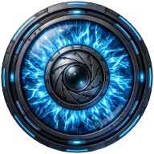
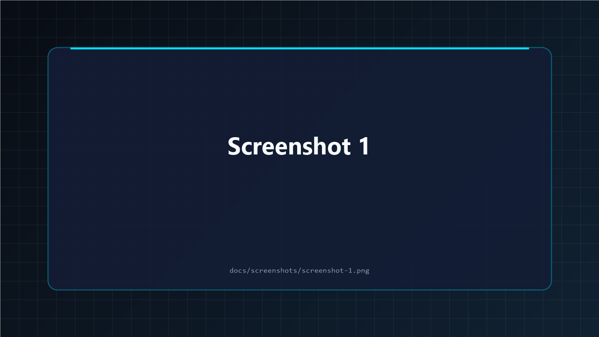
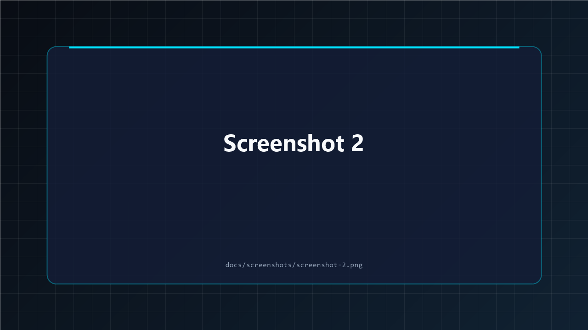
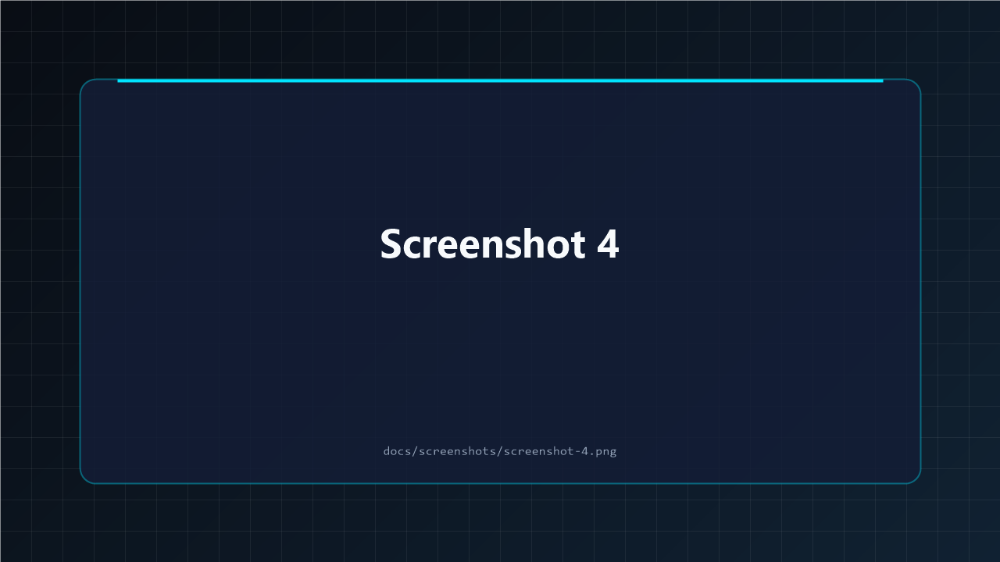
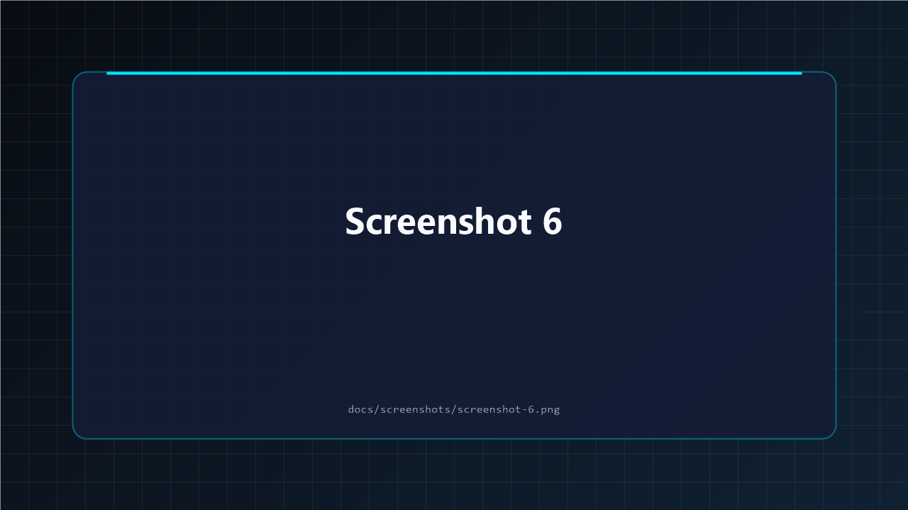
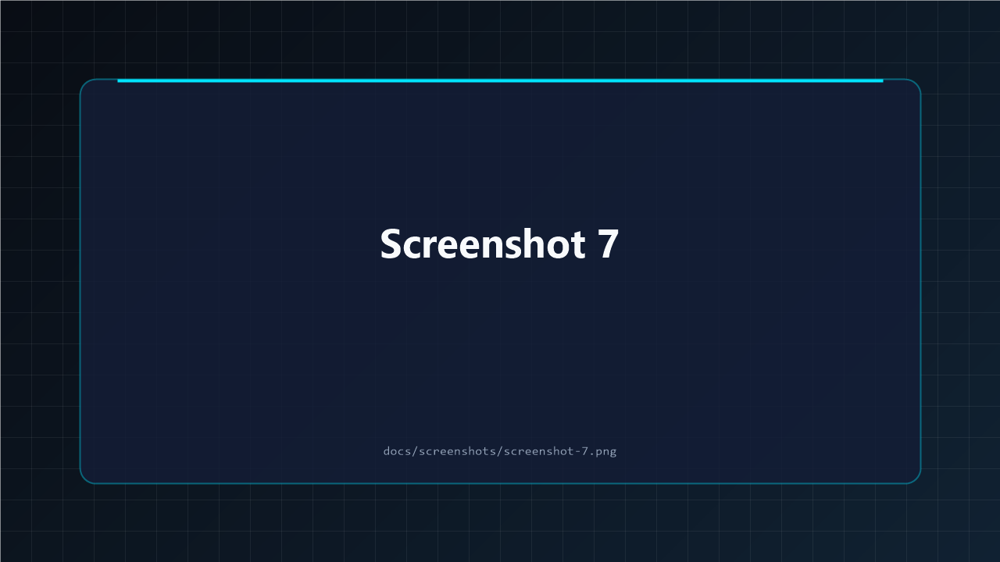
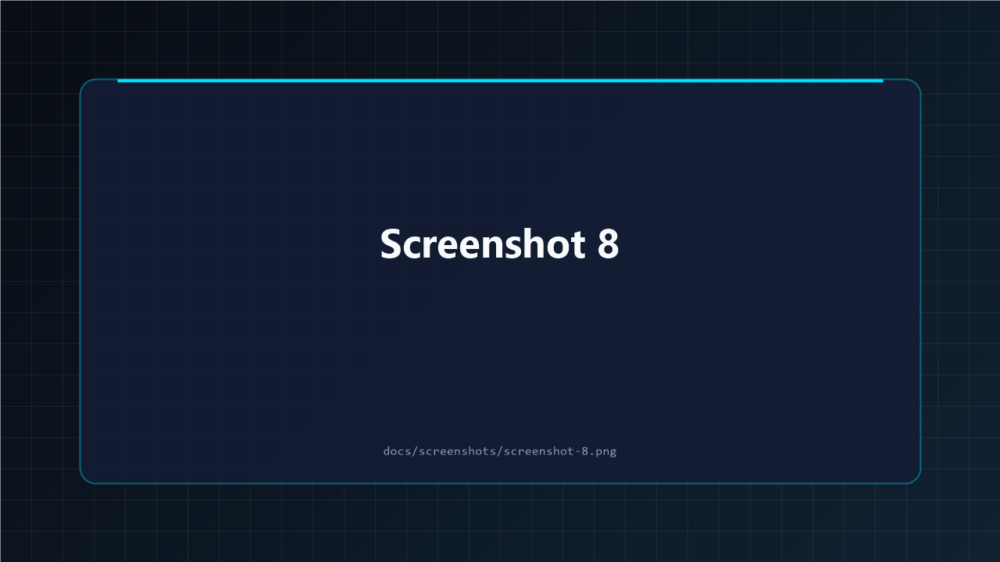

# ModernUI3 — Cyber-Slate Web Interface for Blue Iris NVR

<p align="center">
  
</p>

<p align="center">
  <strong>A Security Operations Center (SOC)–grade dark &amp; light web client for Blue Iris v5 / v6, built on open-source UI3 (base <code>350</code>).</strong>
</p>

<p align="center">
  
  
  
  
  
  
  
</p>

---

## Overview

**ModernUI3** transforms Blue Iris's stock UI3 web client into a modern, responsive, high-contrast monitoring interface with obsidian dark and crisp light themes, a unified multi-track timeline, drag-resizable panels, radar PTZ controls, expanded server telemetry, and opt-in WebGPU hardware decoding with Contrast Adaptive Sharpening (CAS).

Under the hood, the proven Blue Iris video decoding and streaming engines remain unified and intact, while `install.ps1` deploys ModernUI3 side-by-side in its own namespaced paths (`modernui3.htm`, `modernui3/`, `applet/modernui3/`) so Blue Iris program updates never overwrite your UI. ModernUI3 is built upon open-source `bp2008/ui3` and licensed under the **GNU Lesser General Public License v3.0 (LGPL-3.0)**.

### Versioning Scheme

ModernUI3 tracks both its own release maturity and the upstream `bp2008/ui3` base version (`350`):

| Format | Stage | Example | Meaning |
|---|---|---|---|
| `v0.<ui3>.<n>` | Pre-release / Active Development | `v0.348.1`, `v0.348.2`, … | Development builds derived from stock UI3 `<ui3>` |
| `v1.<ui3>.0` | Stable Release | `v1.348.0` | Stable milestone derived from stock UI3 `<ui3>` |

---

## Screenshots

<table>
  <tr>
    <td align="center" width="50%"></td>
    <td align="center" width="50%"></td>
  </tr>
  <tr>
    <td align="center" width="50%"></td>
    <td align="center" width="50%"></td>
  </tr>
  <tr>
    <td align="center" width="50%"></td>
    <td align="center" width="50%"></td>
  </tr>
  <tr>
    <td align="center" width="50%"></td>
    <td align="center" width="50%"></td>
  </tr>
</table>

---

## Key Upgrades Over Base Stock UI3 (350)

### Design System, Dark/Light Themes & 13 Dynamic Accents
* **Three Appearance Modes:** **Dark** (`#090D14` obsidian canvas, frosted glass cards), **Light** (`#F1F5F9` daylight slate with tuned contrast), and **Follow System** (`prefers-color-scheme`), with zero-flicker early `<head>` preboot styling and a one-click top-bar switcher.
* **13 Dynamic Accent Colors:** Instant CSS custom-property re-theming across buttons, active nav pills, timeline laser playhead, loading beam, focus rings, and glowing dropdown swatches:
  * **Electric Cyan**, **Emerald Neon**, **Cyber Violet**, **Amber Gold**, **Crimson Red**, **Glacier White**, **Stealth Gray**, **Liquid Silver**, **Solar Gold**, **Cobalt Blue**, **Synthwave Pink**, **Plasma Orange**, and **Toxic Lime**.
* **UI Density Modes:** Live **Compact**, **Cozy**, and **Comfortable** density selector in the top bar scaling touch targets, padding, gaps, header height, and sidebar widths.
* **Consistent End-to-End Surface System:** Dual-laser translucent loading modal with LED status indicators, Cyber-Slate styled modals/menus/toasts/scrollbars, unified **Camera Properties** cards with semantic action button colors (`Trigger`, `Snapshot`, `Stop Recording`, `Pause`, `Disable`, `Soft Restart`, `Hard Reboot`), themed [storageinfo.htm](modernui3/storageinfo.htm), and a clean-room Cyber-Slate [timeout.htm](modernui3/timeout.htm).
* **Streamlined UI Settings:** Classic-only options (such as legacy Color Theme selectors and live sidebar visibility toggles) are hidden automatically while keeping stock structure intact for future upstream `bp2008/ui3` merges.

### Modern App Shell & Responsive Navigation
* **Modern Header Bar:** Displays the server name dashboard button, live accent-themed **[LIVE]** return indicator, **Profile** dropdown pill, quick-action shortcuts (`Save Snapshot`, `All Clips`, `Alerts Canceled`, `Confirmed Alerts`), density switcher, theme switcher, Main Menu with unread warning counter, and a one-click **Classic UI** link button.
* **Persistent Landscape Sidebar:** Collapsible icon/label navigation (`Dashboard`, `Cameras`, `Alerts`, `Timeline`, `Clips`, `Settings`) with left/right placement support and `localStorage` collapse persistence across reloads.
* **Mobile & Tablet Portrait Experience:** Dedicated bottom navigation bar, an independently collapsible two-column controls drawer (`UI Controls`, `PTZ`), drag resize bar (`#sidebarPortraitDragbar`), stacked video overlay time row on narrow viewports, and zero sticky touch hover highlights.
* **Configurable Startup View:** Launch directly into `Dashboard`, `Cameras`, `Timeline`, `Alerts`, `Clips`, or `Remember Last Used Page`, plus `?page=` / `?cam=` / `?rec=` deep-links.

### Multi-Track Timeline & Server-Side Export Studio
* **Multi-Camera Timeline Rows & Laser Playhead:** Unified per-camera group tracks with optional Unified Alerts view, glowing triangle reticle playhead, floating cursor scrub thumbnail preview card, and 12-speed transport bar with `-10s` / `+10s` step controls.
* **Expandable Zoom Pad & 8-Interval Snap Slider:** Slide-out drawer (`52px` collapsed touch-safe buttons to `280px` expanded) housing a logarithmic slider (`7d`, `2d`, `1d`, `12h`, `6h`, `2h`, `1h`, `30m`) with live pinch-zoom synchronization and persistent width.
* **Dynamic Dark & Light Starfield:** Parallax deep-space / soft-daylight starfield behind timeline history.
* **Interactive Timeline Range Export & Queue:** Drop start/end markers directly on the timeline to trigger server-side multi-clip exports, monitor progress on a high-precision oscilloscope sine-wave beam, and cancel queued/active jobs via non-blocking inline confirmation.

### Clips, Alerts & Playback Experience
* **Resizable Clips / Alerts Panel:** Drag-resizable left sidebar in Clips/Alerts view (persisted in `localStorage`) with scaled cards, AI detection badges, alert-type labels, and dark SVG fallbacks when thumbnails are unavailable.
* **Playback Polish:** Progress scrubber automatically hides during live streaming and appears only during clip/alert playback; theme-aware clip preview filters and arrows; always-available Maximize video overlay button; reliable top/bottom bar restoration when exiting fullscreen; crisp high-contrast light-mode selection highlights.

### PTZ Controls Studio
* **Radar Virtual Joystick:** Concentric target rings, glowing directional chevrons, and an animated draggable center control knob alongside standard multi-speed directional buttons.
* **Presets & Optical Controls:** 5-column glassmorphic preset tiles highlighting configured presets (`.hasPreset`), compact 5-preset toggle option, Home button, IR / Brightness / Contrast row, and universal Zoom/Focus visibility toggle across desktop and mobile.

### Expanded Telemetry & Status Bar
* **Up to 13 Selectable Status Metrics:** Monitor Server **CPU**, **Memory**, **Disk**, **GPU Decode (NVDEC / QuickSync)**, **Active Connections**, **Network Ping (ms)**, **Stream FPS / Smoothness**, **Cameras Online**, and **Server Uptime**, configured via a live item-count slider, drag-and-drop / keyboard-accessible sortable list with a live "Not shown" divider, hover descriptions, and built-in metrics reference guide.
* **Flexible Placement:** Renders inside the expanded landscape sidebar (when enabled) or as a bottom-docked multi-column grid in portrait and collapsed sidebar modes, with optional `"None"` header label, left-aligned expand/collapse chevron, and stoplight/profile shield control.
* **Stats for Nerds Parity:** Fixed-width sparkline telemetry graphs themed for both Obsidian Dark and Daylight Light modes.

### WebGPU Hardware Video Acceleration (Opt-In)
* **OffscreenCanvas Worker Pipeline:** `modernui3/webgpu_video_worker.js` moves WebCodecs (`VideoDecoder`) presentation off the main UI thread onto a dedicated WebGPU worker for smooth 60/120fps UI responsiveness.
* **Zero-Copy Texture Binding & WGSL CAS:** Imports decoded `VideoFrame` objects directly via `importExternalTexture`, applies real-time Contrast Adaptive Sharpening (CAS), paces frames with a target jitter buffer (`RenderScheduler`), reports accurate live source-to-client latency, and automatically falls back to Canvas 2D on context loss.
* **Security & Stability Fixes:** XSS/HTML encoding and same-origin redirect validation across login/timeout flows, single-camera `?cam=` reload reliability, and removal of obsolete PNaCl dead code.

### Update-Proof Side-by-Side Architecture & Optional Cyber-Lens Login
* **Safe Across Blue Iris Updates:** ModernUI3 files (`modernui3.htm`, `modernui3/`, `applet/modernui3/`) live alongside stock `ui3.htm` and `ui3/` without replacing them. A fenced redirect shim inside `ui3/ui3-local-overrides.js` forwards `/` and `/ui3.htm` into `/modernui3.htm`, while stock `/ui3.htm?classic=1` remains instantly accessible (with an injected **Modern UI3** pill button to return).
* **Auth-Exempt PWA & Dedicated Timeout:** Manifest, 21 custom Cyber Eye icons, and optional login theme assets sit in `/applet/modernui3/` so browsers/PWAs fetch them before authentication. Session timeouts land on ModernUI3's own clean-room [timeout.htm](modernui3/timeout.htm) and seamlessly return via [modernui3/ui3.htm](modernui3/ui3.htm) after re-authentication.
* **Fenced Login Theme (`-ThemeLogin`):** Instead of distributing modified Blue Iris `login.htm` source, `install.ps1 -ThemeLogin` injects fenced `<head>` and `<body>` hooks into your existing stock `login.htm` that load [login-theme.css](applet/modernui3/login-theme.css) and [login-theme.js](applet/modernui3/login-theme.js), preserving Blue Iris's native authentication code across updates.

---

## Installation, Upgrading & Uninstalling

### Prerequisites
1. **Blue Iris v5 or v6** with UI3 enabled.
2. In **Blue Iris → Settings → Web server → Advanced**, leave **Root directory** pointing to Blue Iris's standard web folder (default `C:\Program Files\Blue Iris\www`), **not** your git clone folder.
3. **PowerShell running as Administrator** (required to write into `C:\Program Files\Blue Iris\www`).

### Fresh Install (Side-by-Side)

Run the following in **PowerShell as Administrator**:

```powershell
git clone https://github.com/bwenger9/ModernUI3.git
cd ModernUI3

# Standard side-by-side install (leaves stock ui3.htm, ui3\, login.htm, and timeout.htm untouched)
powershell -NoProfile -ExecutionPolicy Bypass -File .\install.ps1 -TargetPath "C:\Program Files\Blue Iris\www"
```

### Manual Installation (GitHub Release ZIP)

If you prefer not to use `git`, download and extract the latest release `.zip` from [GitHub Releases](https://github.com/bwenger9/ModernUI3/releases), then run the install script in **PowerShell as Administrator**:

```powershell
cd C:\Path\To\Extracted\ModernUI3

# Standard side-by-side install (leaves stock ui3.htm, ui3\, login.htm, and timeout.htm untouched)
powershell -NoProfile -ExecutionPolicy Bypass -File .\install.ps1 -TargetPath "C:\Program Files\Blue Iris\www"
```

### Optional: Enable Cyber-Lens Login Page & Custom Icons (`-ThemeLogin`)

Backs up local stock `login.htm`, `favicon.ico`, and `BlueIris.png` to `*.modernui3.bak`, installs the Cyber Eye icons, and injects fenced Cyber-Lens theme hooks into stock `login.htm`. Run in **PowerShell as Administrator**:

```powershell
powershell -NoProfile -ExecutionPolicy Bypass -File .\install.ps1 -TargetPath "C:\Program Files\Blue Iris\www" -ThemeLogin
```

### Upgrading After Pulling Updates

Run in **PowerShell as Administrator**:

```powershell
cd ModernUI3
git pull origin main
powershell -NoProfile -ExecutionPolicy Bypass -File .\install.ps1 -TargetPath "C:\Program Files\Blue Iris\www" -ThemeLogin
```

*(Omit `-ThemeLogin` if you did not install the optional login theme.)*

### After a Blue Iris Program Update
* Your main ModernUI3 installation (`modernui3.htm`, `modernui3\`, `applet\modernui3\`, and `ui3\ui3-local-overrides.js`) survives Blue Iris updates automatically — `/` continues routing straight to ModernUI3 while stock `ui3.htm` and `ui3\` receive Blue Iris's updates cleanly.
* If you use `-ThemeLogin`, Blue Iris installers overwrite `login.htm` and root icons, so re-run `install.ps1 ... -ThemeLogin` in **PowerShell as Administrator** once after updating Blue Iris to re-inject the theme onto the updated `login.htm`.

### Clean Uninstall

Removes `modernui3.htm`, `modernui3\`, `applet\modernui3\`, strips only the fenced ModernUI3 block from `ui3\ui3-local-overrides.js` (preserving any custom user overrides), and restores all `*.modernui3.bak` backups. Run in **PowerShell as Administrator**:

```powershell
powershell -NoProfile -ExecutionPolicy Bypass -File .\install.ps1 -TargetPath "C:\Program Files\Blue Iris\www" -Uninstall
```

---

## Repository File Layout

```text
ModernUI3/
├── applet/
│   └── modernui3/             # Auth-exempt PWA manifest, 21 Cyber Eye logos, icons, login-theme.css & login-theme.js
├── docs/
│   └── screenshots/           # 8 screenshot placeholders (screenshot-1.png .. screenshot-8.png)
├── modernui3/
│   ├── ui3.js                 # Core UI3 application, ModernUIController, and WebGPU player
│   ├── ui3.css                # Cyber-Slate dark/light scoped styles & design tokens
│   ├── modernui3.htm          # Direct subfolder entry stub -> ../modernui3.htm
│   ├── ui3.htm                # Post-login return stub -> ../modernui3.htm
│   ├── timeout.htm            # Clean-room Cyber-Slate timeout screen (update-proof)
│   ├── redirect-shim.js       # Fenced redirect & Classic UI return-pill shim for ui3/ui3-local-overrides.js
│   ├── storageinfo.htm        # Themed browser storage diagnostics & backup/restore tool
│   ├── reset.htm              # Settings reset utility
│   ├── webgpu_video_worker.js # OffscreenCanvas WebGPU + WebCodecs video & CAS sharpening worker
│   ├── icons.svg              # Vector icon definitions
│   ├── libs-ui3.js / .css     # Core UI3 runtime libraries & dialog/toast styling
│   └── help/                  # UI3 help pages & assets
├── install.ps1                # Side-by-side installer, fenced login injector, and uninstaller (run as Administrator)
├── LICENSE                    # GNU Lesser General Public License v3.0 (LGPL-3.0)
├── modernui3.htm              # Main ModernUI3 application entry (Blue Iris server tokens)
└── README.md
```

---

## Usage & Configuration

### Entry URLs & Switching Between ModernUI3 and Stock UI3
* **Default Root (`/` or `/ui3.htm`):** Automatically redirects to `/modernui3.htm` while preserving query parameters (`?cam=`, `?rec=`, `?group=`, etc.).
* **Direct ModernUI3 Entry (`/modernui3.htm` or `/modernui3/modernui3.htm`):** Opens ModernUI3 directly with Cyber-Slate enabled.
* **Switch to Stock Classic UI3 (`/ui3.htm?classic=1`):** Click **Classic UI** in the top bar (or visit `/ui3.htm?classic=1`) to use completely untouched stock UI3. A **Modern UI3** pill appears in the stock top bar whenever you want to switch back (or visit `/ui3.htm?modern=1`).

### Recommended First-Run Settings
Open **Main Menu → UI Settings**:
1. **General Settings → Modern UI Theme / Accent Color / Density:** Pick `Dark`, `Light`, or `Follow System`, choose any of the 13 accents, and set `Compact` / `Cozy` / `Comfortable`.
2. **General Settings → Startup Page:** Choose `Dashboard`, `Cameras`, `Timeline`, `Alerts`, `Clips`, or `Remember Last Used Page`.
3. **Video Player → Enable WebGPU Acceleration (Worker) & WebGPU Adaptive Sharpening (CAS):** Enable on supported Chromium/Edge/modern GPU browsers for off-thread rendering and sharper feeds.
4. **Status Area:** Select how many metrics to display (1–13) and toggle **Show Status Area on Side Bar (when in Landscape mode)** vs. bottom dock.
5. **PTZ:** Choose **Virtual Joystick** (default in ModernUI3) for the Cyber Radar pad or **Classic Buttons**, and set compact 5-preset or expanded 10-preset rows.

### URL Parameters

| Parameter | Alias | Example | Description |
|---|---|---|---|
| `page` | `p` | `?page=cameras` | Opens `dashboard`, `cameras`, `timeline`, `alerts`, or `clips` at startup |
| `tab` | `t` | `?t=timeline` | Selects `live`, `clips`, or `timeline` primary tab |
| `group` | `g` | `?group=Exterior` | Loads a specific camera group on boot |
| `camera` | `cam` | `?cam=Driveway` | Opens a single camera stream directly |
| `rec` | `r` | `?rec=12345` | Opens and seeks directly to a recording/alert clip ID |
| `classic` | — | `/ui3.htm?classic=1` | Launches untouched stock UI3 and remembers Classic mode until returned |
| `modern` | — | `/ui3.htm?modern=1` | Clears Classic mode flag and returns to `/modernui3.htm` |

---

## License & Credits

* **ModernUI3** is licensed under the **GNU Lesser General Public License v3.0 (LGPL-3.0)** — the same license used by upstream UI3. See [LICENSE](LICENSE) for the full license text.
* Built upon **UI3** for Blue Iris — originally created by **bp2008** ([github.com/bp2008/ui3](https://github.com/bp2008/ui3)) and licensed under **LGPL-3.0**.
* ModernUI3 design system, Cyber-Slate themes, clean-room timeout/login injectors, timeline/PTZ/WebGPU enhancements, and Cyber Eye artwork by **Darkstyle** / **bwenger9**.
